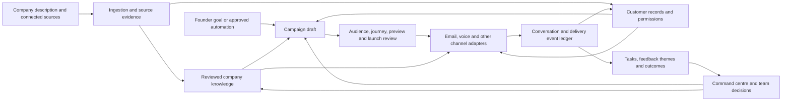

# Company workspace — product alignment, version 2

21 September 2026. Proposed product, not a production specification approved by the founder. Supersedes the narrower conversation-centred walkthrough in `product-walkthrough.md`. The interactive concept is at `/prototype`; all people, interactions and outcomes there are fictional.

## What we are building

A company workspace that turns a founder's goals and company information into coordinated customer work. The company brain provides knowledge; CRM preserves each customer's journey; campaigns organize work across channels; relational voice conducts conversations; the command centre lets people understand, approve, intervene and improve.

The product promise to test is: **your team knows the customer, follows through on the conversation, and can see what actually happened.** Natural voice is the major differentiator we intend to earn. Voice quality and superiority over competitors remain unmeasured.

The starting buyer is an Indian study-abroad consultancy. Company, person, service, campaign, conversation, task and outcome remain general concepts. “Student,” “counsellor,” intake, document readiness and admissions milestones are a configurable industry pack.

## End-to-end experience

| Stage | Founder or team action | Visible result | What happens next |
|---|---|---|---|
| Create company | Enter company name, description, website and goals; optionally answer founder questions | Editable company profile with known and missing information | Choose a template and import sample sources in the mock |
| Connect information | Select CRM, documents, email/calendar and other relevant sources; map fields and ownership | Import preview, duplicates, missing fields, contact permissions and source status | Review proposed knowledge before publishing |
| Build company understanding | Confirm services, audiences, differentiators, answers, prices and constraints from source evidence | A source-linked company brain, with conflicts and unknowns visible | Agents and campaigns use the approved version |
| Set an objective | Ask for a sales, reactivation, service, feedback or research outcome | A proposed campaign brief, success metric and target cohort | Operator edits the draft rather than issuing a blind send |
| Design the campaign | Select eligible audience, journey, channel, schedule, sender/agent and stopping rules | Per-person content preview and a visible sequence | Test and review before launch |
| Review and launch | Review source accuracy, exclusions, contact permission, budgets, capacity and handoff | Campaign version and launch summary | In the mock, launch creates simulated activity only |
| Run and supervise | Monitor progress, replies, interviews, commitments, errors and exceptions | Campaign health with meaningful next actions | Pause/resume, assign a human or fix the underlying issue |
| Understand a customer | Open a person from any campaign or insight | One timeline across enquiry, outreach, calls, service, feedback and tasks | Continue with the right context and corrected preferences |
| Learn from outcomes | Inspect actual counts, conversation evidence and grouped feedback | Facts distinguished from possible explanations | Turn a finding into an owned improvement or a new draft campaign |
| Close the loop | Complete the improvement and send an appropriate follow-up | Recorded task resolution and customer follow-up status | Measure whether the next cohort has a better experience |

Founder interviews are one way to collect company context. They are optional. The word “policies” in the earlier dictation was an error and does not establish a policy-management product requirement.

## Two complete example campaigns

### Sales: enquiries to useful consultations

An operator asks: “Help new enquiries book a useful counselling session.” The system proposes a cohort and excludes opt-outs, duplicate contacts and people already in an active conflicting sequence. The operator reviews a personalized email and a voice follow-up window. Maya uses approved service information and the customer's permitted context. She acknowledges a stated concern, accepts language changes, asks useful questions and prepares a next step. A reply or opt-out stops further automated outreach. A requested appointment is not counted as a confirmed appointment until confirmation exists. Booking is not revenue or enrolment.

### Feedback: completed service to visible improvements

An operator asks: “Find out how customers experienced our recent service.” This creates a **feedback campaign**, not a sales sequence. Its audience is customers who used the selected service, with an appropriate contact permission and timing. A short interview guide asks what worked, what was difficult, and what should change. Customers can decline, reschedule, or ask for a person.

After the interview, the workspace links a transcript excerpt to a feedback theme and the individual record. Summaries distinguish the customer's statement from the agent's interpretation. A complaint becomes an owned service-recovery task; an emerging theme becomes a proposed company improvement. Team members discuss it with relevant context, assign an owner and track progress. Closing an internal task and notifying the customer are separate outcomes. Non-response is not satisfaction. A small sample is not a representative market conclusion.

## The eight surfaces

| Surface | Primary question it answers |
|---|---|
| Overview | What is happening across the company, what needs my attention, and why? |
| Company brain | What do we know, where did it come from, and is it approved/current? |
| Campaigns | What goal are we pursuing, with whom, through what journey, and how is it going? |
| Customers | What has happened with this person, what matters to them, and what did we promise? |
| Voice agents | How does this representative speak, use context, handle corrections and hand off? |
| Insights | What does the evidence show, what remains a hypothesis, and what should we improve? |
| Team & automations | Who owns the next action, what can run automatically, and what needs review? |
| Company setup | Who is this company, what does it offer, and how should the workspace adapt? |

These are views of shared records. They must not become eight separate tools with conflicting customer histories.

## How the layers fit

The voice provider does not own the customer memory. A model may propose an action; a separate execution boundary checks its authority and records the outcome. API-created, founder-created and automation-created campaigns must use the same draft/review/launch machinery. GroupAI contributes coordination and context boundaries, not a second conflicting customer database.

## Emotional and relational voice, concretely

Reuse the work on Maya/Meera as mechanisms: persona configuration separated from relationship behaviour; Hinglish and pronunciation handling; short spoken turns; interruption recovery; corrections; appropriate familiarity; evidence-backed memory; permissions on what can be remembered or disclosed; reliable commitments. Preserve AI disclosure and replace personal-companion identity with a configurable company representative.

A customer saying “I am worried about the cost” is evidence of an expressed concern. It is not permission to infer income, diagnose emotional state or pressure them. The voice should be warm because it listens and responds appropriately. The mock demonstrates the intended conversational behaviour; it cannot demonstrate latency, prosody, audio quality or live language accuracy.

## Automation and model costs

Use deterministic code for eligibility, counters, scheduling and permissions; smaller models for bounded extraction, tagging and draft variants; stronger reasoning for ambiguous synthesis and complex planning; a replaceable realtime lane for conversation. Route by task requirements and measured quality, with fallback and per-workflow budgets. The mock's Fast/Reasoning/Realtime labels describe roles, not a provider choice or verified price quote.

## Scope choices

**Show now:** coherent company onboarding, data/knowledge review, sales and service-feedback campaigns, customer continuity, relational voice behaviour, meaningful campaign health, evidence-based insights, team ownership and simulated API/automation entry points.

**Prove first in production after alignment:** one real enquiry-to-consultation loop and one service-to-feedback-to-improvement loop. These share the same foundations and can demonstrate value without promising to autonomously run every department.

**Future extensions:** hiring, deeper market research, additional department workflows, more channels and telephone numbers, authorized brand-voice replicas. These should inherit the same records and action controls. Do not add modules merely because a source repository contains them.

## Review boundary

The prototype is an executable conversation about the product. It is not registration, an import pipeline, a campaign delivery service or a live voice demo. Review the flow and vocabulary first. The production foundation stays paused until product alignment; no cloud keys are needed for this review.

Repository evidence: `docs/reuse-provenance.md`, `research/html-second-pass.md`, `research/command-centre-product-second-pass.md`, `research/vyakti-audit.md`. Market workflow evidence: `research/product-flow-benchmarks.md`. These reports distinguish static source findings, vendor claims and unvalidated product hypotheses.
