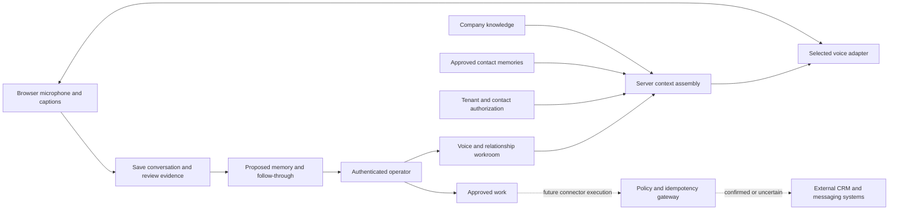

# System flow and boundaries

The first browser is an authenticated **operator test studio**. Selecting a contact authorizes an operator to assemble that workspace's context; it does not verify an external caller's identity. A public customer widget requires its own identity and disclosure policy before exposing contact data.

Company knowledge and customer statements are evidence. Neither can alter server authorization. Only reviewed memory enters cross-session context. Revocation affects future context assembly; an already established provider session may retain earlier context until ended. This limitation must be resolved before external customer pilots that require immediate revocation.

The voice provider owns the active speech session. Our database owns customer records, approved memories and operator task state. A recorded conversation is not authoritative proof that an external action succeeded. Initial follow-through is local human-reviewed work; external connectors must report accepted, confirmed, failed or uncertain outcomes and preserve idempotency.

## Expansion order

1. Verify operator studio with configured providers and recorded test fixtures.
2. Add server-owned voice event/tool transport, automatic source-linked proposals and trace replay.
3. Enforce case/person audience permissions, time-limited evidence, live revocation and verified caller identity.
4. Connect one real CRM/calendar/communications workflow with durable retries and reconciliation.
5. Run paid pilot against baseline business and conversation measures.
6. Add telephone transport after the same context/action boundary is proven.

These are remaining release gates, not claims that these integrations already ship.
