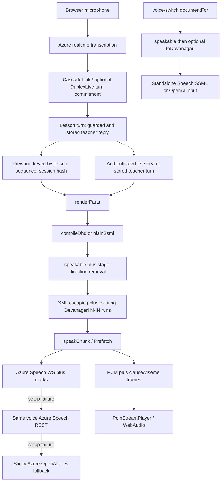

# Taxila teacher voice: source mechanisms and bounded Azure port

Audit date: 2026-10-10. Repository: `raghavsharma2003/Taxila`. Branch: `claude/blissful-mayer-icwe2j`. All source references below are pinned to **`00aab4bdcc787050e65703dd4bb428ce3d9b8679`**, the head supplied by the branch inventory. Source files were downloaded from public, commit-pinned raw GitHub URLs into ignored `data/source-audits/taxila-snippets` and read, never executed. `taxila-teacher-voice-files.json` records their hashes. No provider request, upstream build, cloud operation, credential inspection, or listening test was performed by this audit.

## Main finding

The strongest immediate reuse is a small **Azure Speech SSML compiler that preserves the provided text**, with Taxila's actual Diya/Arjun voice names and current zero-percent base rate. Taxila supplies substantial working code beyond voice prompts, but its educational notation conversion, Roman-Hindi transliteration, child-specific conversation decisions, and audio acknowledgements have different authority and content assumptions from this company application. They are separate adoption candidates, not safe defaults to copy together.

The current company application's native Azure Realtime voice remains a different transport and synthesis path. An Azure Speech SDK sample or replay with Diya is not evidence that native Realtime acquired that voice. The existing fictional Swara baseline, reported by the parent task as 9.338 seconds, is a baseline artifact rather than a Taxila reproduction or perceptual result.

## Actual voice selection and rate

| Path / teacher | Source selection | Rate / condition |
|---|---|---|
| Cascade Asha | `en-IN-Diya:DragonHDLatestNeural` | `baseRate: 0`, row marked measured |
| Cascade Arjun | `en-IN-Arjun:DragonHDLatestNeural` | `baseRate: 0`, row marked measured |
| Cascade Uma | `en-IN-Meera:DragonHDLatestNeural` | `-35`, marked unmeasured; normally unusable until explicitly configured |
| Standalone switch `diya` | Same Diya | Zero base rate |
| Standalone switch `priya` | `hi-IN-Priya:MAI-Voice-2.1` | Preview-labelled, explicit preview gate; different SSML envelope |
| Standalone switch `marin` | Azure OpenAI TTS voice `marin` | Text/instruction interface, not Speech SSML |

These are **source configurations and source labels**, not an independent current availability or GA audit. The operative defaults are in [voices.js L29–64](https://github.com/raghavsharma2003/Taxila/blob/00aab4bdcc787050e65703dd4bb428ce3d9b8679/server/voice/voices.js#L29). Its comments document an earlier character-rate target that selected -35%, followed by an owner listening correction to zero for Asha and Arjun; copying -35% as the winning voice configuration would be wrong. Engine selection prefers DragonHD only when Speech is configured; explicit `oai` wins. An unknown teacher falls back to the Asha row.

`styleForChild` pins the lesson's teacher identity, resolves its spoken-notation cell, and uses the measured/explicitly configured DragonHD row. A lesson that already moved from Realtime to cascade retains its original OpenAI TTS voice rather than changing to Diya. [Route selection L88–98](https://github.com/raghavsharma2003/Taxila/blob/00aab4bdcc787050e65703dd4bb428ce3d9b8679/server/routes/voice.js#L88).

## Verified dependency graph

The separate standalone branch is intentional. At this commit, the inspected live route's `styleForChild`, `expressive/render.js`, `expressive/compile/dhd.js`, and `spoken.js` **do not call `voiceChoice`, `styleFor`, or `toDevanagari`**. The switch file's comments describe broader integration that its inspected callers do not establish. `spokenRun` calls `speakable`, strips stage directions, escapes XML and wraps existing Devanagari; it never transliterates Roman Hindi. Do not turn a header comment into a claim that production synthesis always applies the transliteration feature. [Renderer imports and compiler path](https://github.com/raghavsharma2003/Taxila/blob/00aab4bdcc787050e65703dd4bb428ce3d9b8679/server/voice/expressive/render.js#L10), [spokenRun L27–32](https://github.com/raghavsharma2003/Taxila/blob/00aab4bdcc787050e65703dd4bb428ce3d9b8679/server/voice/expressive/compile/dhd.js#L27), [standalone documentFor L80–115](https://github.com/raghavsharma2003/Taxila/blob/00aab4bdcc787050e65703dd4bb428ce3d9b8679/server/voice/voice-switch.js#L80).

## Spoken English and Hinglish are more than accent instructions

`spoken.js` is a 606-line deterministic notation renderer. `cellFor` selects language mode × school medium × age band; `spoken-lexicon.js` supplies the actual vocabulary, templates, units and operators. English uses English number words. Hinglish with English medium also uses English number words inside Hinglish frames; Hinglish with Hindi medium uses Hindi words and Hinglish frames. Hindi defaults to Hindi medium. Ages 6–9 receive some different fraction and multiplication-chant forms. These are educational conventions, not generic pronunciation fixes. [Cell selection L35–50](https://github.com/raghavsharma2003/Taxila/blob/00aab4bdcc787050e65703dd4bb428ce3d9b8679/server/voice/spoken.js#L35), [cell data L219–227](https://github.com/raghavsharma2003/Taxila/blob/00aab4bdcc787050e65703dd4bb428ce3d9b8679/server/voice/spoken-lexicon.js#L219).

The `toSpoken` prepasses protect designated helpline digit sequences, handle phone-like strings and chemical formulae, then walk notation tokens. `speakable` additionally verbalizes residual digits, applies a term dictionary and replaces ellipses. Those transformations intentionally leave captions/transcripts in written form. They cannot be called text-preserving: company identifiers, dates, quoted text, decimal amounts, product names and bracketed content need their own reviewed rules. [Entry points L566–605](https://github.com/raghavsharma2003/Taxila/blob/00aab4bdcc787050e65703dd4bb428ce3d9b8679/server/voice/spoken.js#L566).

The Roman-Hindi transliterator is an additional heuristic layer, off by default. Its order is: never-convert exceptions; ambiguous-word table; hand vocabulary/verb forms/numbers; explicit English keep table; corpus-learned Hindi; optional spelling-rule fallback. It retains all-caps tokens and some capitalized names. Ambiguous words use nearby Hindi/English evidence; an entire sentence needs an unambiguous Hindi token before conversion. Number context and the conjunction/possessive reading of `ki` get special handling. For example, `saath` can mean “with/together” or be a spelling of sixty; the code specifically avoids the number reading after `ek`/`do`. Safety and identity sentences have preservation gates. These predicates reduce mistakes but do not prove meaning preservation for arbitrary enterprise text. [Analysis L86–144 and preservation L148–182](https://github.com/raghavsharma2003/Taxila/blob/00aab4bdcc787050e65703dd4bb428ce3d9b8679/server/voice/translit/index.js#L86).

`lexicon.js` contains hand vocabulary, ambiguous tokens, names, English keep tokens and generated verb inflections. `lexicon-learned.js` is generated dictionary data, not a runtime LLM. `numbers.js` reuses Hindi number spellings from the spoken lexicon. `rules.js` admits that Roman spellings cannot disambiguate several Hindi consonants. `classify.js` has a spelling-rule classifier and an optional local character-ngram Naive Bayes model loaded from `model-nb.json`; it is not a remote inference call. The default fallback is rules. None is included in the immediate port. [Lexicon](https://github.com/raghavsharma2003/Taxila/blob/00aab4bdcc787050e65703dd4bb428ce3d9b8679/server/voice/translit/lexicon.js#L1), [learned tables](https://github.com/raghavsharma2003/Taxila/blob/00aab4bdcc787050e65703dd4bb428ce3d9b8679/server/voice/translit/lexicon-learned.js#L1), [number mapping](https://github.com/raghavsharma2003/Taxila/blob/00aab4bdcc787050e65703dd4bb428ce3d9b8679/server/voice/translit/numbers.js#L1), [fallback rules](https://github.com/raghavsharma2003/Taxila/blob/00aab4bdcc787050e65703dd4bb428ce3d9b8679/server/voice/translit/rules.js#L1), [classifier L18–44](https://github.com/raghavsharma2003/Taxila/blob/00aab4bdcc787050e65703dd4bb428ce3d9b8679/server/voice/translit/classify.js#L18).

## Prosody and streaming mechanisms

The DragonHD compiler uses per-clause pace offsets of -10/0/+8 percentage points on top of the voice base rate. It can add planned breaks, negative pitch and allowlisted sentence-initial style markers. Its plain compiler still changes content through the spoken renderer. The capability registry says its particular probes heard some bracketed style markers silently but heard paralinguistic tags aloud; those are source-reported probe results, not portable guarantees. The immediate port excludes markers, emotional pitch, stage-direction removal and automated safety-register pacing. [Compiler L14–64](https://github.com/raghavsharma2003/Taxila/blob/00aab4bdcc787050e65703dd4bb428ce3d9b8679/server/voice/expressive/compile/dhd.js#L14), [capability registry L11–50](https://github.com/raghavsharma2003/Taxila/blob/00aab4bdcc787050e65703dd4bb428ce3d9b8679/server/voice/expressive/caps.js#L11).

Streaming is actual implementation: 24 kHz, signed 16-bit mono PCM; an eager `Prefetch` allows the next part to generate while the previous part plays. Short phrases use rendered-content/voice/version cache identity. DragonHD has a per-voice breaker and reply/lesson-sticky fallback so a failure does not alternate voices across subsequent parts. A WS setup failure first retries REST with the same Speech voice; a Speech setup failure can then use Azure OpenAI TTS. That fallback is appropriate evidence to record, but should not be silently inherited in a voice comparison. [Speech dispatch L256–419](https://github.com/raghavsharma2003/Taxila/blob/00aab4bdcc787050e65703dd4bb428ce3d9b8679/server/voice/speech.js#L256).

`azureTts.js` posts SSML with the Speech subscription header and raw-PCM output format, has 4-second response-header and 15-second total defaults, and aborts with the caller. `azureTtsWs.js` hand-builds a TLS/WebSocket client and metadata protocol; it has a pool, reservations, keep-warm and viseme/word offsets. That is significantly more transport code to own than using our installed Speech SDK. A sample needs neither the custom socket stack nor a viseme puppet. [REST implementation L41–101](https://github.com/raghavsharma2003/Taxila/blob/00aab4bdcc787050e65703dd4bb428ce3d9b8679/server/voice/azureTts.js#L41), [WS implementation L55–179](https://github.com/raghavsharma2003/Taxila/blob/00aab4bdcc787050e65703dd4bb428ce3d9b8679/server/voice/azureTtsWs.js#L55).

Prewarm starts only after guarded teacher text exists, binds entries to lesson/sequence/session-token hash, starts part zero plus one lookahead part, expires after 30 seconds and aborts dropped entries. Its stored delivery plan is reused for replay. The TTS route streams only an authenticated stored teacher turn; frames carry PCM, clause timing and viseme metadata. Disconnect-aware backpressure and abort behavior matter more for adoption than copying its latency numbers. [Prewarm L28–128](https://github.com/raghavsharma2003/Taxila/blob/00aab4bdcc787050e65703dd4bb428ce3d9b8679/server/voice/prewarm.js#L28), [stored-turn route L178–220](https://github.com/raghavsharma2003/Taxila/blob/00aab4bdcc787050e65703dd4bb428ce3d9b8679/server/routes/voice.js#L178), [framed playback emission L289–336](https://github.com/raghavsharma2003/Taxila/blob/00aab4bdcc787050e65703dd4bb428ce3d9b8679/server/routes/voice.js#L289).

The browser decoder carries odd PCM bytes between network chunks. Playback begins with a 60 ms lead, can increase lead after underruns, and resumes a paused utterance from a recent quiet gap rather than an arbitrary byte. Framed events and audio offsets synchronize the face. The parser retains incomplete frames; a future enterprise port should add explicit memory/frame-size limits rather than copy this parser without a hostile-input contract. [Decoder and resume point L13–71](https://github.com/raghavsharma2003/Taxila/blob/00aab4bdcc787050e65703dd4bb428ce3d9b8679/src/lesson/ttsStream.ts#L13), [frame parser L139–179](https://github.com/raghavsharma2003/Taxila/blob/00aab4bdcc787050e65703dd4bb428ce3d9b8679/src/lesson/ttsStream.ts#L139).

## Turn-taking, acknowledgement and conversation behavior

The cascade transcription session cannot answer: it is explicitly type `transcription`, with near-field reduction, requested logprobs and server VAD. Its prompt asks for Hindi words in Devanagari and English in Latin, without lesson vocabulary. Both child age bands use 900 ms endpoint silence; the source describes very limited synthetic evidence, not a general human optimum. Native Realtime separately adds context retention and 900–1200 ms pacing bounds, plus quota-triggered cascade fallback. [STT L12–78](https://github.com/raghavsharma2003/Taxila/blob/00aab4bdcc787050e65703dd4bb428ce3d9b8679/server/voice/stt.js#L12), [Realtime seam L36–95](https://github.com/raghavsharma2003/Taxila/blob/00aab4bdcc787050e65703dd4bb428ce3d9b8679/server/voice/realtimeSession.js#L36).

`CascadeLink` implements pause-then-decide interruption with local energy and server speech-start signals; brief backchannels/echo can resume, whereas an actual turn stops output. `DuplexLive` adapts microphone frames, STT events, output events and a timer into an engine/port contract; a transcript final alone is not turn authority. It can revoke a premature committed turn and reject its stale reply. The acoustic tracker uses RMS/f0 for timing, explicitly not affect labels. These are rich but tightly coupled to Taxila's engine and lesson context. Our current final-transcript authority and cancellation contracts must remain authoritative. [Cascade contract L1–37](https://github.com/raghavsharma2003/Taxila/blob/00aab4bdcc787050e65703dd4bb428ce3d9b8679/src/lesson/cascadeLink.ts#L1), [duplex contract L1–60](https://github.com/raghavsharma2003/Taxila/blob/00aab4bdcc787050e65703dd4bb428ce3d9b8679/src/duplex/live.ts#L1), [acoustic tracker](https://github.com/raghavsharma2003/Taxila/blob/00aab4bdcc787050e65703dd4bb428ce3d9b8679/src/duplex/audio.ts#L1), [native VoiceLink](https://github.com/raghavsharma2003/Taxila/blob/00aab4bdcc787050e65703dd4bb428ce3d9b8679/src/lesson/voiceLink.ts#L1).

ACK means a spoken echo of a screened answer token, not protocol acknowledgement or generic filler. Server code requires a classified graded answer, excludes distress/stop/content-filter conditions, avoids consecutive ACKs and caps four per ten turns. A fixed decision instant defaults to 1200 ms to avoid signalling correctness through timing. The browser requires final text equal to the text used for the ACK, rejects stale/interrupted clips, and does not start one after the real reply begins. Defaults include 3500 ms freshness, 1800 ms maximum reply hold and 180 ms reply gap. This is meaningful source machinery but must not be copied into business calls as assent to an unverified claim or external action. [ACK decision L45–111](https://github.com/raghavsharma2003/Taxila/blob/00aab4bdcc787050e65703dd4bb428ce3d9b8679/server/latency/ack.js#L45), [client limits and finality gates](https://github.com/raghavsharma2003/Taxila/blob/00aab4bdcc787050e65703dd4bb428ce3d9b8679/src/latency/ack.ts#L47).

`understand.js` produces a constrained note, not the spoken reply. `policy.js` maps that note into requests while preserving graded outcomes and code-decided stop/safety precedence. `compose.js` constructs a bounded lead plus an exact card question and rejects leads that disclose a key or contradict the pending question. The transferable idea is that code owns authoritative facts and boundaries while generation phrases the connective speech; the school grading schema itself is not the company's action policy. [Understanding L109–154](https://github.com/raghavsharma2003/Taxila/blob/00aab4bdcc787050e65703dd4bb428ce3d9b8679/server/conversation/understand.js#L109), [policy L87–113](https://github.com/raghavsharma2003/Taxila/blob/00aab4bdcc787050e65703dd4bb428ce3d9b8679/server/conversation/policy.js#L87), [composition L102–138](https://github.com/raghavsharma2003/Taxila/blob/00aab4bdcc787050e65703dd4bb428ce3d9b8679/server/conversation/compose.js#L102).

Voice-feature learning likewise is not an emotion detector: it validates numeric acoustic/temporal features, baselines against the same child/context and limits downstream suggestions. Its population and purpose differ from enterprise callers, so neither child norms nor slower-pace inference are imported. [Feature schema and baseline L28–74](https://github.com/raghavsharma2003/Taxila/blob/00aab4bdcc787050e65703dd4bb428ce3d9b8679/server/voice/features.js#L28).

## Immediate implementation contract sent to the port implementer

1. Adapt `escapeXml` and `langRuns` from `expressive/compile/dhd.js` L17–21 and the envelope construction of `voice-switch.js` L95–100. Accept already-written text and preserve its characters, spacing, numbers, punctuation and brackets. Decode the generated XML text nodes to assert exact equality in tests.
2. Use a finite server-side preset allowlist: Diya and Arjun at `+0%`, outer `en-IN`, existing Devanagari runs `hi-IN`. Do not select a voice from arbitrary request text. Treat successful synthesis on the approved Speech resource as availability evidence for that resource only.
3. Invoke the existing installed Azure Speech SDK server path for this isolated preview/replay. Preserve authorization, payload/output caps, timeouts and cleanup. Report selected voice, requested profile and actual result; do not silently fall back to another voice for the sample.
4. Preserve native Azure Realtime as the default. Identify the artifact as a separate Azure Speech synthesis comparison. A later live cascade adapter needs its own session epoch, interruption, backpressure, memory/action authority and browser playback integration.
5. Exclude `speakable`, `stripStageDirections`, transliteration, sentiment/affect inference, style markers, ACKs and custom WebSocket transport from this first port. Reuse of these requires separate explicit behavior contracts and adversarial bilingual examples.

Useful verification cases: mixed Devanagari/English; Roman Hinglish left exactly as given; rupees/phone/date/identifier literals; ampersands and XML-looking input; brackets and asterisks; whitespace and punctuation; English-only text; finite preset validation; cancellation/timeout/failure with no mislabeled fallback. Human listening and microphone/barge-in quality remain separate unverified gates.

## Provenance and license boundary

The requested source is the user's repository. Root `LICENSE` returned 404; the inspected `package.json` says `private: true` and has no license field. This does not establish any open-source license. The source-inventory task owns the exhaustive tree/license finding; until then, retain exact repository/commit/file attribution and the user's requested reuse context. Do not label this code MIT, Apache or public domain. Third-party dependencies retain their own licenses. The proposed handful of functions is an attributed adaptation, not a whole-repository merge.

This report distinguishes source code from source comments and historical probe claims. It demonstrates mechanisms and bounded integration opportunities; it does not establish superiority, deployed configuration, provider availability, audited safety, or measured improvement in the company application.
