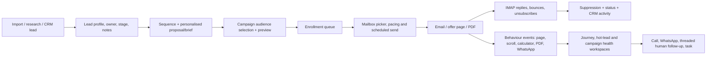

# CommandCentre product audit: second pass

Audited source: `research-sources/command_centre` at `c8fd321` (3 September 2026). This is a code and route audit of the current working tree, not a README summary or a claim that its production credentials are configured. The source tree was read only.

## What the product actually is

CarbonSettle CommandCentre is a fairly substantial sales-operations CRM built around a CBAM outbound engine. Its strongest, genuinely implemented product loop is:

It also contains a conventional lead CRM, shared tasks, team chat, manual outreach, website-lead handling, public personalised proposal pages, WhatsApp workflows, SEO/site analytics and integration/webhook configuration. It is **not** a founder/company onboarding system, customer-success workspace, feedback-program product, quote-to-contract system, general automation builder or AI data-storytelling product.

The primary sidebar has **22** entries (6 Daily Flow + 6 Outbound + 1 Team + 5 Workspace + 4 Setup). These are navigation entries, not Git branch heads: the earlier repository audit inventoried 21 remote branches. Cold Engine adds a separate 15-tab horizontal sub-navigation, and several useful direct/public routes sit outside both navs. This second pass traces the main-tree product flow in depth; the all-branch dispositions remain in `command-centre-audit.md` and `branch-inventory.json`.

## Primary sidebar: every user-visible head

| Sidebar area | Actual user-visible capability | Useful prototype interpretation |
|---|---|---|
| Home | Owner-scoped daily command dashboard: pipeline KPIs, follow-up priority, shared-task focus, recent activity, stage distribution and owner performance. | Founder’s daily brief and action queue. |
| Inbox | Full-screen inbound email triage with intent facets, thread view, translation, AI draft, manual reply, redirect, archive/delete/read handling and meeting-invite action. | Unified customer/prospect inbox, not just a notification feed. |
| Calls | Follow-up call queue segmented into urgent, week, retry, cold, number research and proposal queue; call outcomes advance lead state. | Sales / CS calling workbench. |
| Pipeline | Filterable CRM table with bulk actions and a lead detail sheet. The sheet holds contact/company data, owner, stage/reaction, notes, activity/touch history and email/WhatsApp actions. | Core account/contact record. |
| Tasks | Shared tasks with status, priority, assignee, due date and linked lead. It has a particularly good import-review task flow for ambiguous imported rows. | Cross-functional action tracker. |
| Outreach | One-to-one/batch manual email and WhatsApp composition, templates, PDF preview/attachment, sending queue and delivery board. | High-touch sales/CS execution. |
| Cold Engine | Dedicated multi-mailbox cold-email system; expanded below. | Campaign operating system. |
| WhatsApp | Meta Cloud API dashboard and campaign builder: template sync, audience-by-stage preview, draft campaign creation, queued batch sends, delivery/read/click/reply KPIs. | Separate channel campaign lane. |
| Manual WhatsApp | Finds a lead, builds an editable personalised wa.me message and offer link, opens the handset workflow, then logs the manual send. It deliberately does not claim to send an attachment through wa.me. | Useful assisted-sales pattern. |
| Hot Leads | Cross-channel engagement queue for repeated offer-page visits, downloads or claims; rule score plus optional AI score/reason/next action; call/WhatsApp/threaded-email actions and handled state. | Best existing "what should I do now?" surface. |
| Exporter Follow-up | A specialised exporter campaign route, rather than a generic account program. | Evidence that campaign-specific operating surfaces can be valuable. |
| Importers | Separate EU-importer ICP view and campaign path, distinct from exporter CRM. | ICP-specific campaigns should retain their own data and messaging. |
| Team Chat | Channels, direct/team messages, file upload, reactions, search and push-notification controls. | Useful collaboration substrate, though not tied to a customer case by default. |
| Activity | Daily activity dashboard for calls, outreach, demos and stage movement, with trends route. | Operational cadence reporting. |
| Reports | Funnel, aging, SLA, owner workload and outreach reporting. | Management report surface. |
| Website Leads | Captures and works inbound form/claim leads; lets an operator complete missing fields, preview/edit a template, send email/WhatsApp and inspect their public-offer activity. | Inbound conversion queue. |
| Website Analytics | Website sessions, traffic sources, pages, devices, countries, people, custom funnel, heatmaps and health. It identifies known cold-email leads and can hide email-security scanners. | Separate acquisition analytics, not campaign reporting. |
| SEO & Search | Google Search Console dashboard: query/page/geo/device views, opportunities and service-account setup guidance. | SEO operations, not general BI. |
| Import | CSV/XLS/XLSX lead import wizard with auto-map, source/owner/stage defaults, insert/update mode, deterministic reconciliation, preview, audit rows and tasks for ambiguous matches. | The strongest reusable company/contact ingestion pattern. |
| Templates | CRUD message templates; variables, email/WhatsApp channel, attachment type, duplicate, visual preview and PDF preview. | Content library, although it lacks programme governance. |
| Integrations | Saves masked configuration for Calendar, Aircall/dialer, WhatsApp Business, Gmail/IMAP and Mailgun. Runtime usage is limited mainly to booking/dial URLs and provider webhooks. | Provider configuration, not an integration marketplace or workflow builder. |
| Settings | SMTP status/test email, static two-person owner list, resumable batch phone verification and CSV export. | Admin utilities, not organisation setup. |

Direct/non-sidebar product surfaces worth retaining in the inventory:

- `/cold-email/free-quarter-launch`: an isolated passphrase-protected campaign launcher with a preflight preview. It is campaign-specific, not a reusable launch product.
- `/emailer`: alternate emailer campaign board; `/investor`: a hard-coded, explicitly non-live investor demo.
- `/p/<token>` and `/p/<token>/pdf`: signed personalised public offer page, calculator, brief download, claim capture and behavioural tracking. It has exporter/free-quarter and EU-importer variants and a “valid link, missing CRM row” graceful fallback.
- `/unsubscribe`: signed one-click public unsubscribe that writes the global suppression list.

## Cold Engine: the real campaign product

### 1. Audience/data preparation

There are three actual entry paths:

1. **CRM import** maps CSV/XLS/XLSX headers such as company, decision-maker, product, EU evidence, source, stage and owner. It reconciles against existing company/website/email/phone data; updates eligible matched fields; creates an audit record; and opens a review task instead of silently resolving ambiguous matches.
2. **Research Leads** is a staging table for deeply researched stakeholder records. An operator approves/rejects individual or bulk records, then an explicitly passphrase-gated action promotes deliverable addresses into CRM leads and enrolls them in a sequence tagged `research_hq`.
3. **Campaign launch modal** offers “verified safe” (email status active), “by stage” or individually selected CRM leads. It shows audience size, mailbox capacity estimate, renders a sample of every sequence step and can open a generated PDF preview.

The engine does enforce at enrollment: duplicate-email de-duplication, existing enrollment avoidance, global suppression, disqualified CRM stages and confirmed bad/wrong-domain scope. `requireEuSignal` exists in the service layer, but the generic Campaign UI does **not** set it. Its default “Verified safe” label means email deliverability, not a visibly auditable exporter/ICP proof. A modern prototype should make identity, consent/basis, ICP qualification and data freshness explicit in the audience review rather than infer them from “safe”.

### 2. Sequence and personalisation

Users can create an active/inactive multi-step sequence, edit the sequence metadata, and create/update/delete steps. A step supports:

- day/hour delay;
- multiple subject variants (A/B); spintax validation; plain or HTML body;
- `{{variables}}` filled from lead fields;
- stop-on-reply / stop-on-open flags;
- optional personalised PDF attachment type;
- preview against a real selected lead, with unresolved tokens called out.

The render layer creates a signed per-lead proposal/free-quarter URL, resolves spintax and variables, appends the unsubscribe footer to cold first touches and conditionally appends an open pixel. The campaign-specific tuning route can enable open tracking and add an AI-generated peer-style subject test only after an authorised confirmation.

### 3. Review, launch and queue

Launch creates an `emailer_campaigns` row and enqueues the selected leads into `sequence_enrollments`. The visible modal has no separate draft/review/approval state: clicking Launch makes the campaign `active` and starts each queue item at “now.” Preview is available but optional. Capacity is displayed as a simple total daily mailbox cap estimate.

The specialised Free Quarter launcher is more cautious: it shows wave/pool/eligible/already-enrolled/mailbox counts before a passphrase-protected POST. The Harvest panel similarly makes high-intent download follow-ups and held follow-ups preview-by-default, with an authorised “arm” action. These are valuable patterns to generalise into one reusable launch checklist: audience snapshot, exclusions, send window, sender set, content preview, expected duration, owner/approver and explicit arm/launch.

### 4. Dispatch and deliverability

This is real server-side machinery, not a decorative campaign table.

- `send-pending` runs every two minutes, only weekdays 09:00–16:00 IST, with a global rolling hourly cap and deliberately uneven batch sizes.
- A worker atomically leases a due enrollment, rechecks suppression, chooses/reserves a suitable warmed mailbox, uses mailbox caps/gaps/domain placement information, records the outbound send, and advances to the next step in the lead’s business time zone.
- It supports sticky mailbox continuity, attachment generation, transient SMTP retry/backoff, permanent failure handling and double-send guards.
- Mailboxes have SMTP/IMAP connection testing, encrypted credentials, active/pause state, daily/hourly caps, warm-up/ramp/throttle/reputation fields and per-domain stats.
- Deliverability includes hard/soft/block bounce parsing, hard bounce/complaint/unsubscribe suppression, soft-bounce policy, DNS SPF/DKIM/DMARC/blocklist checks, inbox placement seed tests, Postmaster data and a health summary intended for monitoring.

The product has strong operational depth but weak operator-facing campaign control: the campaign list has no general pause/resume, schedule editor, clone, change log, approval gate, live queue drilldown or clear one-click abort. The health model is also tied to an email fleet rather than a channel-agnostic campaign health concept.

### 5. Replies, CRM updates and suppression

Inbound mail is collected through IMAP polling and matching. Replies are classified into meeting, positive, question, partnership, referral, neutral, not relevant, wrong person, OOO, auto reply, negative, bounce, unsubscribe and spam. The inbox prioritises hot/needs-action messages, can translate non-English replies, extracts redirect contacts and enables threaded manual replies.

An inbound reply marks the enrollment replied, clears its next send, globally suppresses the address, updates CRM context and increments mailbox/domain reply stats. Hard/block bounces do the equivalent bounce/suppression path; soft bounces follow a retry policy. A reply can trigger an idempotent, same-mailbox PDF auto-reply; AI-written auto-replies are deliberately off unless an explicit setting enables them.

The global Suppressions UI shows source/reason and supports manual additions/removal. Reasons include hard/soft bounce, complaint, unsubscribe, manual, replied, duplicate audience, invalid verification and role address. The mechanism is reusable and should be a first-class safety layer in the expanded prototype.

### 6. Campaign health, activity and performance

There are overlapping but useful analytics surfaces:

| Surface | What it measures | Important nuance |
|---|---|---|
| Cold dashboard | active/total mailboxes, day/week sends, replies/bounces, enrollment buckets, per-campaign sent/replied/bounced and recent replies | Campaign rows are backed by actual step-0 send records, not guessed status. |
| Audiences | one cohort scoreboard: enrolled, sent today, delivered, bounced, offer-page opened, replied, hot and converted, plus 7-day send trend | Cohorts appear from `audience` tags; roll-up de-dupes leads. |
| Campaign funnel | sent, email open, offer page, reply, claim, hot, bounce; grouped by wave, sequence, mailbox, subject variant and sequence step | Downstream metrics are de-duped per lead inside a group. |
| Proposal analytics | sent → open → page → PDF → WhatsApp → reply; hot/warm/cold cards and actionable per-lead queue | “Open tracking” may intentionally be off for deliverability; page visit is the reliable signal. |
| Journeys | per-lead sessions, active time, scroll depth, section dwell, calculator use, downloads, WhatsApp/outbound click, returns and 0–100 intent score | Strong consumer-style behavioural journey, particularly valuable for personalised offers. |
| Hot Leads | engagement/claim/downloads plus optional AI ranking/reason/next action and immediate sales actions | Good candidate for a universal "priority work" layer. |
| Deliverability/placement | hard and soft bounce rates by window/domain/campaign, DNS authentication, domain health, seed inbox/spam/missing result | This is genuine sending-infrastructure health rather than a simple campaign KPI. |
| Activity, reports, site analytics, SEO | staff activity/SLA/funnel; website visitor acquisition/behaviour; Search Console performance | Keep these separate from lifecycle/campaign metrics in a redesigned IA. |

The most valuable branch-specific nuance is that the system is careful about **security scanners inflating engagement**. Public offer tracking filters headless/curl user agents, and website analytics labels/hides email scanners. The September campaign notes also document that apparent engagement was often a mail-security sandbox. Any prototype must label confidence/known-human status and must not blindly treat an open, click or page view as customer intent.

## Proposals, offers and quotes

The product has unusually developed **personalised proposal/offer assets**, but not a commercial quoting system.

- The public signed offer routes present company/product-aware content, CBAM scenarios and savings calculator, personalised PDF brief, WhatsApp path and claim form. Events record view, claim, scroll/session, calculator, download and contact clicks.
- PDF routes generate several proposal/brief variants; templates and outreach can preview/attach them. Custom proposal modal accepts a bespoke brief and file upload, and the manual/engagement paths can send a threaded PDF follow-up.
- The importer route has a separate buyer-side offer variant. A valid signed link degrades gracefully if its CRM record is missing, preserving the prospect experience.

What is missing: a customer-facing quote object with products/line items, price/discount/tax/currency, versioning, owner/approver, sent/viewed/accepted/expired lifecycle, e-sign/contract/payment handoff, or revenue forecast. “Proposal” currently means a generated persuasive brief, not a commercial proposal-to-close workflow.

## Customer onboarding, service feedback and team collaboration

The source talks about CarbonSettle onboarding in proposal copy and uses generic CRM stages such as onboarding, but it does **not** implement a founder/company setup wizard, customer account profile, service plan, onboarding checklist, policy/offer catalogue, customer health, implementation workspace or document/data-ingestion workflow. The Import wizard ingests prospect/CRM rows, not a customer’s company data or operational documents.

There is no user-visible feedback campaign, survey/NPS/CSAT form, interview scheduler/script, response repository, theme/sentiment analysis, improvement action register, closed-loop customer follow-up or customer feedback reporting. Searching application code found no feedback/interview/CSAT/NPS domain model; the occurrences are project documentation or marketing copy.

Existing controls that are useful foundations:

- **Team Chat** supplies channels, message/file upload, reactions, search and push settings.
- **Tasks** supplies assignees, priorities, statuses, due dates and lead links; its import-review resolution is a good example of collaborative, evidence-preserving action.
- **Activity log**, owner scope and lead timeline give basic accountability.
- **Calendar integration** stores a booking URL and can prefill company/contact metadata; reply triage surfaces meeting requests.

They are not joined into a customer service case or feedback loop. The expanded product should make one feedback/interview response produce an accountable insight/action, attach it to the customer, alert the right team, and show the customer that the loop has been closed.

## Automation, APIs and AI: actual status

### What exists

- Cold-email cron workflows for sends, inbox polling, reply classification/digest, health scan, deliverability alerts, ramp/throttle recompute, placement and webhook dispatch.
- An outbound webhook endpoint UI: create URL + subscribed events; it generates a secret once, signs HMAC payloads, stores failures and supports pause/delete. This is a real no-code *outbound event subscription* feature.
- Provider inbound webhook route for WhatsApp/Mailgun/generic payloads and a configuration screen that encrypts/masks declared secrets.
- Configurable link integrations (Calendar booking, dialer, WhatsApp sender, IMAP mailbox); the runtime endpoint mostly resolves booking/dial URLs.
- Narrow AI features: reply classification/translation, optional auto-reply drafting, hot-lead score/reason/next action and peer-style subject variants. They have fail-open heuristics/fallbacks and explicit controls around auto-sending.

### What does not exist

- No workflow canvas, trigger/action editor, conditional branches, reusable automation templates, test-run/audit UI or user-created API endpoints.
- No general API builder, API keys/roles, event catalogue/docs, data mapping UI or integration OAuth connection flow.
- No grounded “ask your business” assistant that selects data, produces a chart/narrative, explains evidence and lets a founder save/share a story. The investor-page chat is explicitly canned and hard-coded.
- No AI analysis of service/interview feedback or automatic recommendation-to-action workflow.

## Requirements checklist for the expanded `sales-enabler` prototype

Use this as the product scope, ordered by the important workflow rather than by the source’s current navigation.

### Foundation and onboarding

- [ ] First-run founder onboarding: company profile, brand/voice, ICPs, team roles, sales motion, channels, sender identities, timezone and baseline goals.
- [ ] Customer/company account object distinct from a prospect: company profile, contacts, products/services, commercial status, owner, documents/data sources, timeline and relationship health.
- [ ] Import company/contact data through a mapping + preview + reconciliation + exception-review workflow modelled on CommandCentre’s import wizard.
- [ ] Central offer library with audience eligibility, value proposition, assets, pricing/terms placeholders, channel suitability and lifecycle/version status. Do not put these rules only inside individual email templates.

### Sales campaigns and personalised outreach

- [ ] Campaign creation flow: objective → ICP/audience → qualification and suppression review → channel → offer → content/sequence → sender/pacing → per-person preview → owner/approval → scheduled launch.
- [ ] Audience review must show qualification evidence, contact consent/basis, duplicate/previous-contact history, invalid/suppressed reasons and expected reachable count. Do not use an ambiguous “verified safe” label.
- [ ] Sequence editor with variables, subject/content variants, delays, stop rules and exact recipient preview; preserve the source’s unresolved-token warning.
- [ ] Personalised outreach assets: offer page/landing page, short proposal/brief, quote, attachments and an optional calculator. Capture actions as evidence, with scanner/bot confidence.
- [ ] Queue state that is visibly distinct: draft, ready for review, approved, scheduled, armed, sending, paused, completed, stopped and failed; support safe pause/resume/abort, clone and a launch audit record.
- [ ] One threaded conversation history across email, manual WhatsApp, calls, meetings and notes; give human operators editable but safely previewed send actions.

### Campaign health and journeys

- [ ] Campaign control room with queue/sends/delivery/bounce/reply/unsubscribe/conversion, pacing versus plan, sender capacity and clear next actions.
- [ ] Drill down from every metric to people/accounts, then from a person to chronological journey and CRM changes.
- [ ] Per-campaign and cross-campaign comparisons by audience, offer, channel, sequence step, content/subject variant, sender and time period.
- [ ] Separate funnel analytics, email-deliverability health, website/acquisition analytics and customer-health metrics so counts remain interpretable.
- [ ] Bot/scanner detection and confidence labelling; reporting should favour confirmed human/page/claim/reply signals over email opens.
- [ ] Global suppression/consent centre with source/reason, automatic events, manual control and recheck immediately before send.

### Proposals, quotes and conversion

- [ ] Keep personalised brief/offer generation, PDF preview and engagement tracking.
- [ ] Add a true quote object: line items, pricing, discount/tax/currency, expiry, versioning, approval, delivery, view/accept/reject state and conversion to agreement/payment/implementation.
- [ ] Account-level commercial timeline linking campaign touch, meeting, proposal, quote, decision and onboarding handoff.

### Customer service feedback and collaboration

- [ ] Feedback campaign builder for interview invitations, survey/CSAT/NPS and follow-up reminders; select customer segment, owner and channel.
- [ ] Interview workspace: scheduling, participant/account context, discussion guide, notes/transcript, consent/status and attached evidence.
- [ ] Feedback analysis: response dashboard, themes/sentiment, verbatim evidence, segment/time comparison, confidence/volume and AI-suggested insights with human edit/approval.
- [ ] Closed-loop improvement actions: convert an insight into task/project, assign owner/date/priority, connect to affected customers, post team updates, mark outcome and send customer follow-up.
- [ ] Customer health timeline that mixes usage/engagement, support/interview feedback, open actions, renewal/commercial state and risk/opportunity flags.
- [ ] Preserve chat and tasks, but add customer/campaign/feedback context, mentions/notifications and a unified activity trail.

### Automation, API and AI storytelling

- [ ] Visual but constrained automation builder: trigger, filters, conditions, action, delay, test preview, approval requirement, run log and kill switch. Begin with safe templates such as “reply → create task”, “feedback detractor → notify owner”, and “quote accepted → create onboarding plan”.
- [ ] Integration centre with real connected status, capability/scope, field mapping, test action, sync/run history and secure secret/OAuth flow. Reuse the source’s masked-secret and webhook-health ideas.
- [ ] API/webhook product: API keys/roles, schema/event catalogue, inbound/outbound logs, replay/test tools and data mapping. The current outbound-webhook UI is a useful starting point, not the final capability.
- [ ] Grounded AI data storyteller: founder asks a question or chooses a goal; system selects cited live metrics, visualises trend/funnel/segments, states uncertainty (including bot noise), proposes actions, and lets a human save/share/assign the narrative. It must not imitate the source’s canned investor chat.

## Source evidence map

The principal implementation evidence is in:

- Navigation and surface inventory: `components/layout/sidebar.tsx`, `components/cold-email/section-nav.tsx`.
- CRM/import/tasks/team/manual outreach: `components/import/import-wizard.tsx`, `components/pipeline/lead-detail-sheet.tsx`, `components/tasks/task-board.tsx`, `app/team/page.tsx`, `components/outreach/compose-flow.tsx`.
- Campaign UI/sequence/editor/queue: `app/cold-email/campaigns/page.tsx`, `app/cold-email/sequences/[id]/page.tsx`, `app/api/cold-email/campaigns/route.ts`, `app/api/cold-email/sequences/*`, `lib/cold-email/sequence-engine.ts`, `app/api/cron/send-pending/route.ts`.
- Replies/suppression/health: `app/inbox/page.tsx`, `lib/cold-email/imap-poller.ts`, `lib/cold-email/reply-classifier.ts`, `lib/cold-email/auto-reply.ts`, `lib/cold-email/suppression.ts`, `app/cold-email/deliverability/page.tsx`, `app/cold-email/placement/page.tsx`.
- Engagement/journeys/offers: `app/cold-email/proposal-analytics/page.tsx`, `app/cold-email/journeys/page.tsx`, `app/hot-leads/page.tsx`, `app/p/[token]/page.tsx`, `components/proposal/*`.
- WhatsApp, integrations, automation hooks and AI: `app/whatsapp/page.tsx`, `app/api/whatsapp/*`, `components/integrations/integration-center.tsx`, `app/api/cold-email/webhooks/*`, `app/api/integrations/*`, `lib/cold-email/ai-draft.ts`, `app/api/hot-leads/score/route.ts`.
